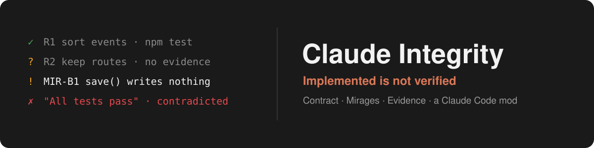

<p align="center">
  
</p>

<h1 align="center">Claude Integrity</h1>

<p align="center">
  <strong>"All tests pass." Did they run? Claude Integrity checks what your coding agent claims against what it actually did.</strong>
</p>

<p align="center">
  <sub>A Claude Code mod that keeps a requirement contract from your own words, flags code that only looks finished, counts a requirement as verified only after a real passing check, and audits completion claims. Everything stays on your machine.</sub>
</p>

<p align="center">
  <a href="https://github.com/NMenzel/claude-integrity-mod/stargazers"></a>&nbsp;
  <a href="https://github.com/NMenzel/claude-integrity-mod/releases/latest"></a>&nbsp;
  <a href="LICENSE"></a>&nbsp;
  <a href="https://claude.com/blog/claude-code-mods"></a>
</p>

<p align="center">
  <a href="#install">Install</a> · <a href="#use-it">Use it</a> · <a href="#the-dashboard">Dashboard</a> · <a href="#what-it-checks">What it checks</a> · <a href="#commands">Commands</a> · <a href="#options">Options</a> · <a href="docs/SECURITY.md">Security</a>
</p>

---

## The problem

**Claude Code ends a task with a confident summary.** "Implemented the save
flow. All tests pass." Often that is true. Sometimes:

- **The tests never ran.** Or they ran before the last three edits, or failed behind a `| tail`.
- **The code only looks finished.** A save handler returns `{ ok: true }` and writes nothing. A button's `onClick` is `() => {}`. The "live" list still reads `mockEvents`. A service throws `new Error("Not implemented")`.
- **The task drifted.** You said "do not create another Discover page", and there is now `app/discover-v2/page.tsx`. You said to leave `app/legacy/**` alone, and it was edited.

Checking all of that by hand, after every turn, is the work you wanted to hand off.

## The solution

**Claude Integrity compares four things while Claude works**, built on Claude Code's native Mods API:

1. **What you asked for**: a requirement contract drafted from your own words (*Intent Fingerprint*).
2. **What changed**: every edit, scanned for fake completeness and scope drift (*Mirage Detector*).
3. **What proves it**: real test, build, lint and typecheck runs, tied to the code they ran against (*The Witness*).
4. **What was claimed**: "all tests pass", "it's implemented" and similar lines in Claude's final answer, checked against that evidence (*Claim Auditor*).

| In Claude Code today | With Claude Integrity |
| --- | --- |
| "All tests pass." in the final answer | A note beneath the answer: `? "All tests pass.": no test run was observed for this task` |
| A test run that scrolled past three edits ago | **Evidence** tied to the source state. Edits after the run mark it ⧗ stale |
| `return Response.json({ ok: true })` and nothing saved | **MIR-B1**: a POST handler returns success with no write, query, fetch or service call |
| "Do not create another Discover page" in your prompt | **DRIFT-N1** when a new file is named after a second Discover page |
| Re-reading the diff to see what is really done | A **status line**, `Integrity  ✓ 2/5 verified · ? 3 unverified · ! 1 finding · ⧗ 1 stale`, and a dashboard per requirement |
| Hoping review catches it | **Strict mode** refuses edits to excluded paths, and `claude -p "/integrity-check"` exits 1 on violations |

**Nothing is verified because a model said so.** A requirement is verified
only by a real, passing, current check of a kind that can prove it, or by
your own confirmation.

**Native mod. No wrappers, no API keys, no network calls. No model calls unless you turn on `/integrity-suggest`. Two commands to install.**

It sees what the Mods API exposes: your prompts, Claude's tool calls and
their results, and the files Claude edits. It does **not** see tests you run
in your own terminal or in CI (confirm those with `/integrity-verify`). Its
rules read source text, not a syntax tree, so every finding that is not
literal is marked *potential*. It never approves a tool call and never
rewrites Claude's answer.

> [!TIP]
> If Claude Integrity catches a "done" that wasn't, **a ⭐ on the repo** helps other developers find it.

Claude Integrity is a community project. It is not made or endorsed by Anthropic.

## Requirements

- Claude Code with Mods support. Built and tested on **2.1.294** (Windows 10). Mods need 2.1.287 or later, and builds older than 2.1.294 are untested.
- The dashboard pane is built for the terminal and the Code tab of Claude
  Desktop. In the VS Code chat panel and in `claude -p` the hooks still run,
  and every `/integrity-*` command answers as text.

## Install

Inside Claude Code:

```text
/plugin marketplace add NMenzel/claude-integrity-mod
/plugin install integrity@claude-integrity-mod
/reload-plugins
/integrity-help
```

Or from a terminal, in one command (it adds the marketplace too):

```sh
claude plugin install integrity --marketplace NMenzel/claude-integrity-mod
```

Then run `/reload-plugins` in an open session, or start a new one.

The installer may say config options aren't set. The defaults are fine, and
[`/config`](#options) changes them. Mods are an early-access Claude Code
feature, and their API can change between releases.

Check that it loaded: run `/plugin` and look for `integrity` in the
`mods active` line. You can also run `/integrity-help`.

To update: `claude plugin update integrity@claude-integrity-mod`.
To remove: `claude plugin uninstall integrity@claude-integrity-mod`.

### Install with an AI agent

Paste this into Claude Code, or any coding agent that can run shell commands:

```text
Install the Claude Integrity mod for Claude Code from
https://github.com/NMenzel/claude-integrity-mod. Follow the
"Instructions for agents" in its README, then tell me what to run next.
```

#### Instructions for agents

If you are an AI agent installing Claude Integrity for a user, follow these steps.

1. **Check the version.** Run `claude --version`. Claude Code 2.1.287 or later supports mods, and Claude Integrity is tested on 2.1.294. If the version is older, stop and tell the user to update Claude Code (`claude update`).
2. **Install, without prompts:**
   ```sh
   claude plugin install integrity --marketplace NMenzel/claude-integrity-mod --json
   ```
   This adds the marketplace to the user's settings and installs at user scope. Exit code 0 means it is installed. To share it with everyone working in the current repository, add `--scope project` (it is then recorded in `.claude/settings.json`). Ask the user before using a scope other than the default.
3. **Options are optional.** The defaults suit most users. Set an option only if the user asked for it, with `--config <option>=<value>` on the install command. Examples: `--config notify=all`, `--config autoCapture=false`. All options are listed under [Options](#options).
4. **Verify:** `claude plugin list --json` includes `integrity@claude-integrity-mod`.
5. **Hand over to the user.** An agent cannot activate a mod inside the user's running session. Tell the user to run `/reload-plugins`, then `/integrity-help`. A newly started session loads the mod by itself.

Notes for agents:

- Nothing needs to be built, and it needs no npm packages, global installs or `sudo`. Do not clone the repository to install it.
- The mod makes no network calls and no model calls by default. It never approves a tool call and does not change the user's permission settings.
- To test it headlessly: `claude -p "/integrity-help"` prints the help without a model call. In Git Bash on Windows, prefix `MSYS_NO_PATHCONV=1` so the shell does not turn `/integrity-help` into a path.

## Use it

1. **Describe a task** the way you normally would: "Enrich the existing Discover page with live events. Do not create another Discover page. Tests must pass." Integrity drafts a contract from the explicit requirements and constraints. No model call is made, and nothing is approved for you. To start one by hand: `/integrity-start <task>`.
2. **Review it** with `/integrity-contract` (short: `/igc`). Edit it in place:
   ```text
   /integrity-contract add Events are fetched from /api/events
   /integrity-contract edit R2 Keep the existing /discover route
   /integrity-contract crit R2 should              # must | should | optional
   /integrity-contract check R1 npm test           # this command proves R1
   /integrity-contract exclude app/legacy/**       # never touch these paths
   /integrity-contract intent prototype            # fixtures are expected, not findings
   ```
3. **Approve it** with `/integrity-approve` (`/iga`). That freezes the baseline. Later changes become versioned revisions.
4. **Work normally.** The status line under the prompt keeps count: `Integrity  ✓ 2/5 verified · ? 3 unverified · ! 1 finding · ⧗ 1 stale`.
5. **Open the dashboard** with `/integrity`, or `/ig`. Keys `1`-`7` switch between Overview, Requirements, Evidence, Findings, Claims, Activity and Report. Press a row for details. `k` acknowledges a finding, `w` waives it (a reason is required), `c` re-checks, `e`/`j` export.
6. **Hand it over** with `/integrity-report export` (`/igr export`). It writes `.claude/integrity/<task>.md` and `.json`.

### The dashboard

`/ig` opens it. It is drawn in the style of [Claude Flightdeck](https://github.com/scasella/claude-flightdeck), and docked beside a fullscreen transcript it asks for the same 66 columns:

- A centered title, `INTEGRITY · STRICT MODE · APPROVED V2`, over a color legend.
- **CONTRACT**: the task, one colored cell per requirement (verified, implemented, not verified, stale, failed), a `▰▰▰▱▱ 3/5 verified · must 2/3` gauge, and the open problems.
- **EVIDENCE**: the latest run of each kind of check, fresh or ⧗ stale.
- **FINDINGS**: counts by severity and the top three open findings. Press one to open its details.
- **CLAIMS**: the verdicts on Claude's last answer, and the worst two claims with their reasons.
- The top concern in a card of its own (`i` inspects it), `a` approve, `c` re-check, and the activity log.

From 110 columns the cards sit side by side in two columns. Inline above the
prompt it is a three-line summary. With the `color` option off, the glyphs
(✓ ◐ ? ⧗ ✗) carry every state on their own.

## What it checks

### Intent Fingerprint: the contract

Each requirement is your own sentence, with a criticality (`must`, `should`,
`optional`), a category (functional, constraint, non-functional, test,
preservation) and how it can be proved (static, test, runtime, manual).
Exclusions (`exclude <glob>`), scope (`scope <glob>`) and intent
(`production`, `prototype`) shape how strict the checks are.

The contract lives in the mod's own store, keyed per repository, outside the
conversation. Compaction cannot drop it, and a new session picks it up.

### Mirage Detector: code that only looks finished

Twelve rules for JavaScript, TypeScript, React and Next.js, each with its
confidence:

- **Placeholders**: `throw new Error("Not implemented")` (confirmed), TODOs that defer the real work, `example.com` endpoints and `YOUR_API_KEY`.
- **Simulated success**: a mutating handler that returns success with no IO, a `setTimeout` delay followed by a success state.
- **Inert controls**: `onClick={() => {}}`, log-only handlers, `href="#"`.
- **Mock data shipped as real**: `mockEvents` in a production view (expected in a prototype).
- **Incomplete integration**: a fetch whose result is never read, a client calling `/api/x` that no observed route serves, a save that only sets state, a `fetch` with no error handling, role-gated UI over unguarded handlers.

And seven **intent drift** rules: edits to excluded paths, edits outside the
scope, a new file named after something you said not to recreate, a new
route while routes must be preserved, deleted code files, near-total
rewrites, and new dependencies the contract never mentions.

Every finding is `confirmed`, `potential` (it says what to check) or
`expected` (allowed by the contract, shown but never counted). Acknowledged
and waived findings stay quiet across later scans. The full list, with each
rule's false-positive guard, is in [docs/DETECTION-RULES.md](docs/DETECTION-RULES.md).

### The Witness: evidence

Test, build, lint, typecheck, migration and browser-test runs that Claude
makes become evidence: the command, the outcome, the counts the runner
printed (jest, vitest, mocha, pytest, cargo, go, node:test), and the git
`HEAD` they ran against.

- A run that was **denied, synthetic, sent to the background, interrupted** or had its exit status **masked** by a pipe or `|| true` is never a pass.
- An edit to a related file after the run makes it **⧗ stale**.
- A browser session without an assertion is **inconclusive**. Clicking around is not a test.
- What Claude cannot run, you confirm: `/integrity-verify R3 submitted the form and reloaded: saved`.

### Claim Auditor

When Claude finishes, Integrity reads the final answer for completion claims
("all tests pass", "it's implemented", "uses live data", "production-ready")
and checks each against the evidence: supported, partial, unsupported,
contradicted or not assessable. When one is unsupported or contradicted, a
short note appears beneath the answer:

```text
Integrity · 2 completion claims checked: 1 partial · 1 unsupported
  ? "All tests pass.": no test run was observed for this task
  details: /integrity claims
```

The answer itself is never changed. Hedged ("should pass") and negated
sentences are skipped on purpose: a missed claim is better than a false alarm.

## Modes

- **observe** (default): records, flags, and adds a note beneath an answer when a claim is unsupported or contradicted. Never blocks anything.
- **review**: also lists open must-requirements and high findings after each answer, and opens the pane.
- **strict**: refuses edits to paths the *approved* contract excludes (a real tool-call refusal), and makes `/integrity-check` exit 1 on policy violations. It cannot stop a turn from completing, because the Mods API has no such hook. It says so instead of pretending.

Set it per project with `/integrity-mode observe|review|strict`.

To use the check as a gate in a script or a git hook on the machine where the
contract lives:

```sh
claude -p "/integrity-check"     # exit 1 under strict mode when a policy is violated
```

## Commands

| Command | Does |
| - | - |
| `/integrity [view]` | Open the pane (in a headless session: print the status). `/integrity <subcommand>` runs `/integrity-<subcommand>` |
| `/integrity-start [text]` | Start a contract from the text, or from your last prompt |
| `/integrity-contract [action]` | View or edit the contract (`add`, `edit`, `remove`, `crit`, `category`, `verify-by`, `check`, `exclude`, `scope`, `assume`, `intent`, `summary`) |
| `/integrity-approve` | Approve the baseline or a revision |
| `/integrity-check` | Re-read tracked files, re-scan and evaluate policies. Exits 1 under strict mode on violations |
| `/integrity-findings [all\|ack <id>\|reopen <id>]` | List or triage findings |
| `/integrity-evidence [link E# R#]` | List evidence, or link a check to a requirement |
| `/integrity-verify R# <what you checked>` | Record your own confirmation |
| `/integrity-report [md\|json] [export]` | Print or export the delivery report |
| `/integrity-mode observe\|review\|strict` | Set the mode for this project |
| `/integrity-waive <id\|R#> <reason>` | Waive a finding or requirement, with a reason |
| `/integrity-reset [all] [confirm]` | Delete the active task (or all of this project's data) after confirmation |
| `/integrity-ui [setting value ...]` | Status hint, notifications, color, findings per page, open or close the pane |
| `/integrity-layout auto\|mini\|compact\|wide` | Pane layout |
| `/integrity-suggest` | Opt-in AI requirement suggestions: one model call, results marked proposed |
| `/integrity-help` | The workflow in short |
| `/ig [view\|subcommand]` | Short for `/integrity`: `/ig check`, `/ig start <task>` and every other subcommand work too |
| `/igc` · `/iga` · `/igv` · `/igf` · `/igr` | Short for `/integrity-contract`, `/integrity-approve`, `/integrity-verify`, `/integrity-findings` and `/integrity-report` |

## Options

Set them in `/config`, or at install time with `claude plugin install ... --config <option>=<value>`:

| Option | Default | Meaning |
| - | - | - |
| `notify` | `important` | Hints and notes beneath answers: `off`, `important` (only unsupported or contradicted claims) or `all` |
| `statusHint` | `true` | The one-line status under the prompt |
| `paneAutoOpen` | `false` | Open the pane when a session starts (only where it docks as a sidebar) |
| `layout` | `auto` | Pane layout: `auto`, `mini`, `compact` or `wide` |
| `maxFindings` | `8` | Findings per pane page, 1 to 50 |
| `color` | `true` | Color the status glyphs (the glyphs always carry the meaning) |
| `autoCapture` | `true` | Draft a contract from an implementation prompt when no task is active. Never approves it |
| `retentionDays` | `30` | Idle tasks older than this are deleted, 1 to 3650 |
| `gitProvenance` | `true` | Record the git `HEAD` with each piece of evidence (`git rev-parse`, read-only) |
| `aiAssist` | `false` | Allow `/integrity-suggest` to make one model call per request |

`/integrity-ui` and `/integrity-layout` change the display options without leaving the session.

## Privacy

Local only: no telemetry and no network calls. The only processes it starts
are two read-only `git` commands for provenance (off with `gitProvenance`).
It stores a hash of your prompt and a short redacted excerpt, never the full
prompt and never raw tool output. Credentials, tokens and home-directory
paths are redacted. Details: [docs/SECURITY.md](docs/SECURITY.md).

## Verified vs. limited

Covered by 66 automated tests (`claude plugin test`) and a real headless load (`claude -p --plugin-dir`):

- Contracts: capture, approval, versioned amendments, persistence across processes, per-repository isolation.
- Evidence: test, build, lint, typecheck, migration and browser runs; denied, synthetic, background, interrupted and exit-masked runs are never a pass; freshness and staleness.
- The twelve Mirage rules and seven drift rules on fixture projects, with expected-mock handling and persistent waivers.
- Claim auditing (supported, partial, unsupported, contradicted, not assessable) and the note beneath the answer.
- The pane on the terminal, desktop and mobile element tables at narrow, typical and wide widths, docked and inline, with and without color, with working presses, inputs and paging.
- The short aliases answering exactly as the commands they stand for.
- The strict gate exiting 1 in a real headless process.

Not covered by tests: how the terminal and Desktop paint the pane (the test
kit checks the drawn trees, not the pixels). See [docs/LIMITATIONS.md](docs/LIMITATIONS.md).

## Develop and test

```bash
npm install                      # local TypeScript only; nothing global
claude plugin validate .         # manifest, hooks, calls, state contract
claude plugin test .             # 66 tests: pure engine + real hooks and pane through claude-code/testing
npx tsc -p .                     # type-check (after one load has laid .claude-plugin/types)
```

The engine writes `.claude-plugin/types/` the first time it loads the
folder. To lay it without starting an interactive session, run once:
`claude -p --plugin-dir . "/integrity-help"`.

See [docs/ARCHITECTURE.md](docs/ARCHITECTURE.md), [docs/DETECTION-RULES.md](docs/DETECTION-RULES.md),
[docs/API-COMPATIBILITY.md](docs/API-COMPATIBILITY.md), [docs/SECURITY.md](docs/SECURITY.md) and
[docs/LIMITATIONS.md](docs/LIMITATIONS.md). [CONTRIBUTING.md](CONTRIBUTING.md) has the ground rules;
changes are listed in [CHANGELOG.md](CHANGELOG.md).

## License

[MIT](LICENSE)
